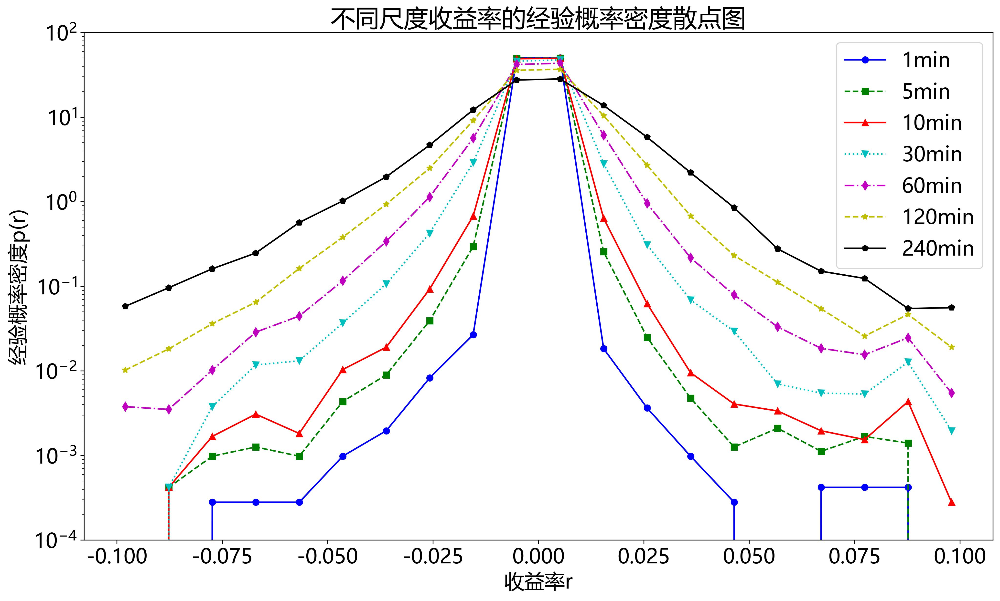
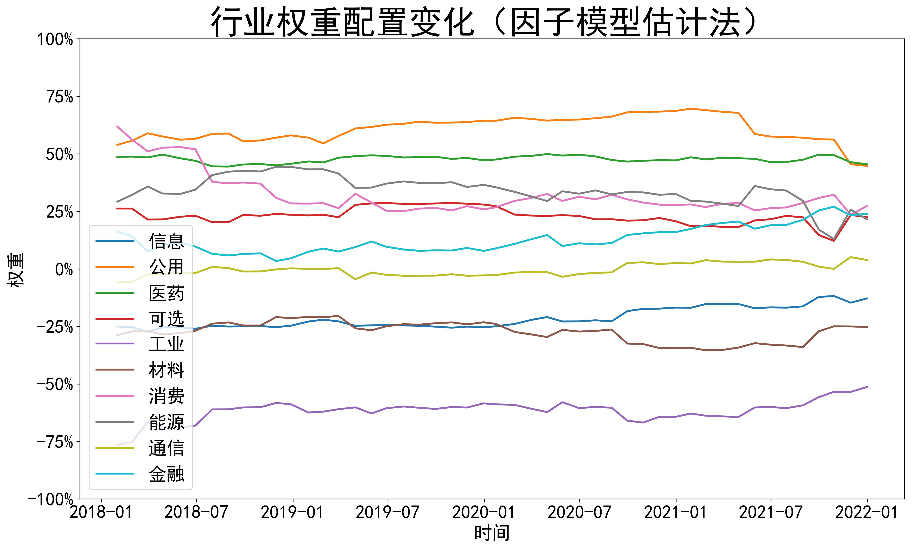
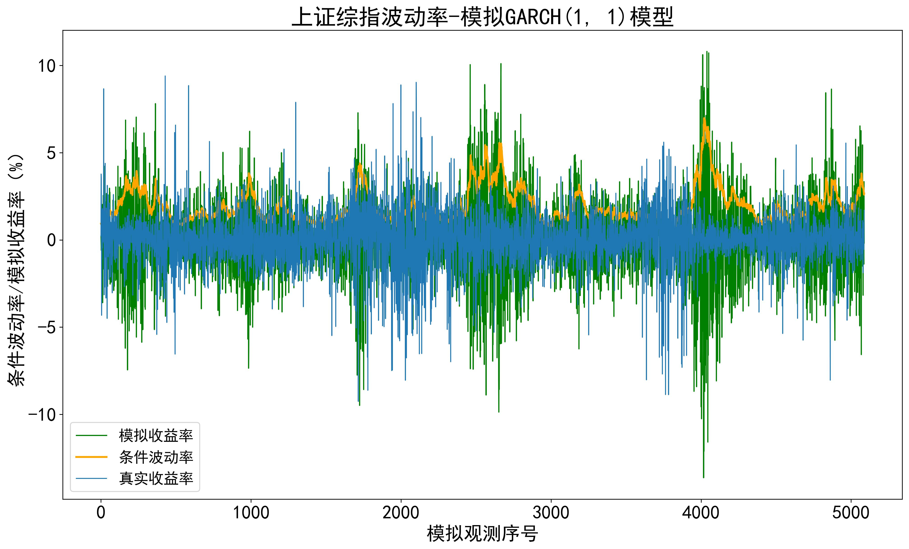

# 大数据与金融计算

[English](README.md)

Python 课程作业，涵盖收益率分布、资产定价、组合配置、波动率与风险分析。

## 作业目录

| 作业 | 内容 |
| --- | --- |
| [01](assignment-01/README.zh-CN.md) | 收益率分布 |
| [02](assignment-02/README.zh-CN.md) | CAPM 与收益率规律 |
| [03](assignment-03/README.zh-CN.md) | 因子模型与横截面检验 |
| [04](assignment-04/README.zh-CN.md) | 收益率可预测性 |
| [05](assignment-05/README.zh-CN.md) | 协方差估计与组合配置 |
| [06](assignment-06/README.zh-CN.md) | 金融网络数据采集 |
| [07](assignment-07/README.zh-CN.md) | 条件波动率 |
| [08](assignment-08/README.zh-CN.md) | VaR 与回测 |

[课程论文：AI 相关股票与资产定价](course-paper/README.zh-CN.md) · [金融数据获取练习](supplementary/README.zh-CN.md)

## 结果展示

### 七种采样尺度下的收益率经验分布

在对数密度坐标上，对照1分钟至240分钟共七种采样尺度的收益率经验分布。

[作业01 · 代码](assignment-01/homework_01.py)

### 因子模型下的行业组合权重

展示2018—2021年因子协方差估计下的行业配置变化；负权重表示空头敞口。

[作业05 · 代码](assignment-05/homework_05.py)

### GARCH(1,1) 模拟与条件波动率

对照随机模拟收益率（绿）、其条件波动率（橙）和历史指数收益率（蓝）。

[作业07 · 代码](assignment-07/homework_07_01.py)
