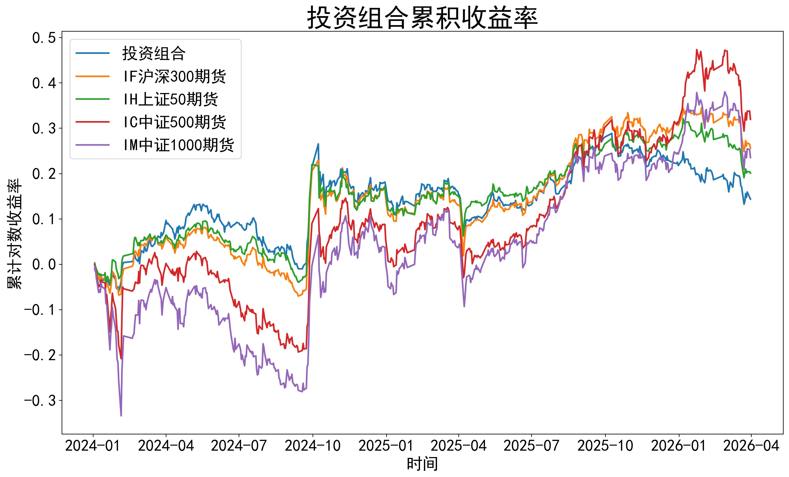
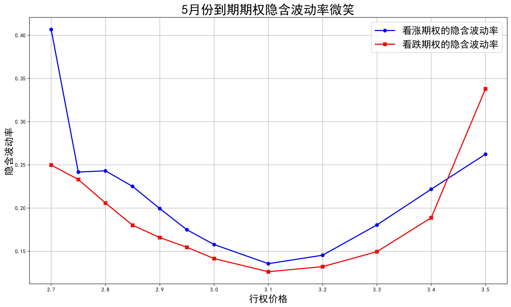
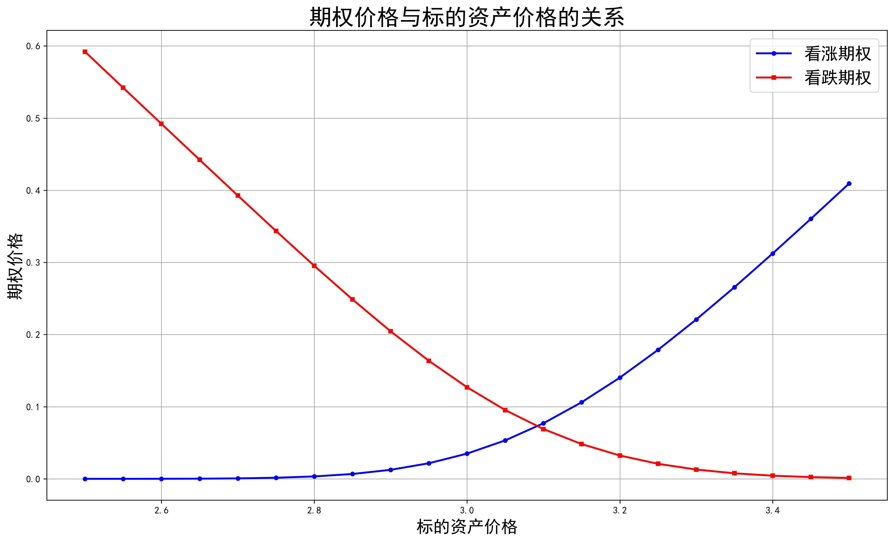

# 金融工程导论

[English](README.md) | [中文](README.zh-CN.md)

本课程是 [Programming Coursework Portfolio](../README.zh-CN.md) 的一部分，按每次作业组织。目前公开 4 个课程 Python 文件，不含检查工具，四次作业脚本均已收录。

<!-- gallery:start -->
## 精选图表

以下为原作业目录中保存的历史 Matplotlib 输出，保留原图标签；本次未在代码审计后重新生成。图表对应代码见各图下方，验证范围见[质量说明](QUALITY.zh-CN.md)。

### 股票组合与股指期货累计收益对照



对照股票组合与 IF、IH、IC、IM 股指期货的五条累计对数收益曲线；对应套保回归前的历史样本比较。

[作业01 · 期货套保](assignment-01/sample_01.py)

### 隐含波动率微笑



对5月到期课堂样本按行权价反解 BSM 隐含波动率：蓝线为看涨、红线为看跌。求根与输入价格一致性的限制见作业说明。

[作业04 · 数值反解定价](assignment-04/sample_04.py)

### BSM 期权价格对现价的敏感性



固定其他课堂参数，比较看涨期权（蓝线）与看跌期权（红线）价格随标的现价的变化。

[作业03 · 期权敏感性](assignment-03/sample_03.py)

<!-- gallery:end -->


## 作业目录

| 作业 | 内容 |
| --- | --- |
| [01](assignment-01/README.zh-CN.md) | 股指期货套期保值 |
| [02](assignment-02/README.zh-CN.md) | 国债期货久期套保 |
| [03](assignment-03/README.zh-CN.md) | BSM 期权价格敏感性 |
| [04](assignment-04/README.zh-CN.md) | 隐含波动率微笑 |

## 环境与数据

在本课程目录安装依赖：

```bash
python -m pip install -r requirements.txt
```

再进入相应作业目录运行具体脚本。输入文件、字段、版本标记和原有问题见各作业说明。外部数据需另行获得授权；这里不分发数据库原表、教师课件、原题、答题模板、私人报告或来源未核实的课堂参考代码。

## 归属与验证

署名使用 Jason。课程指定任务、AI 辅助版本和已知限制按实际情况标注。后续定点修复及十组合成测试见[仓库审计记录](../AUDIT.zh-CN.md)。

Python 语法、双语文档配对和本地链接已检查；部分数值函数通过隔离合成测试，历史实证结果未全面复算。详见[质量说明](QUALITY.zh-CN.md)与[英文课程说明](README.md)。公开可见不等于授予第三方资料的再分发许可；本仓库尚未选择开源许可证。
