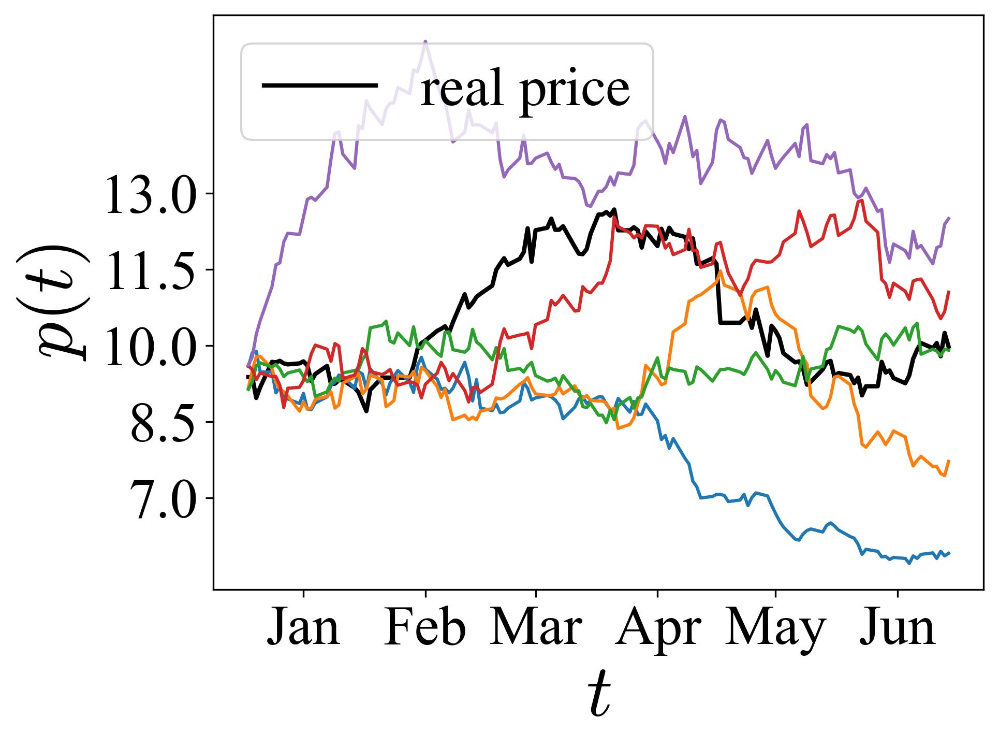
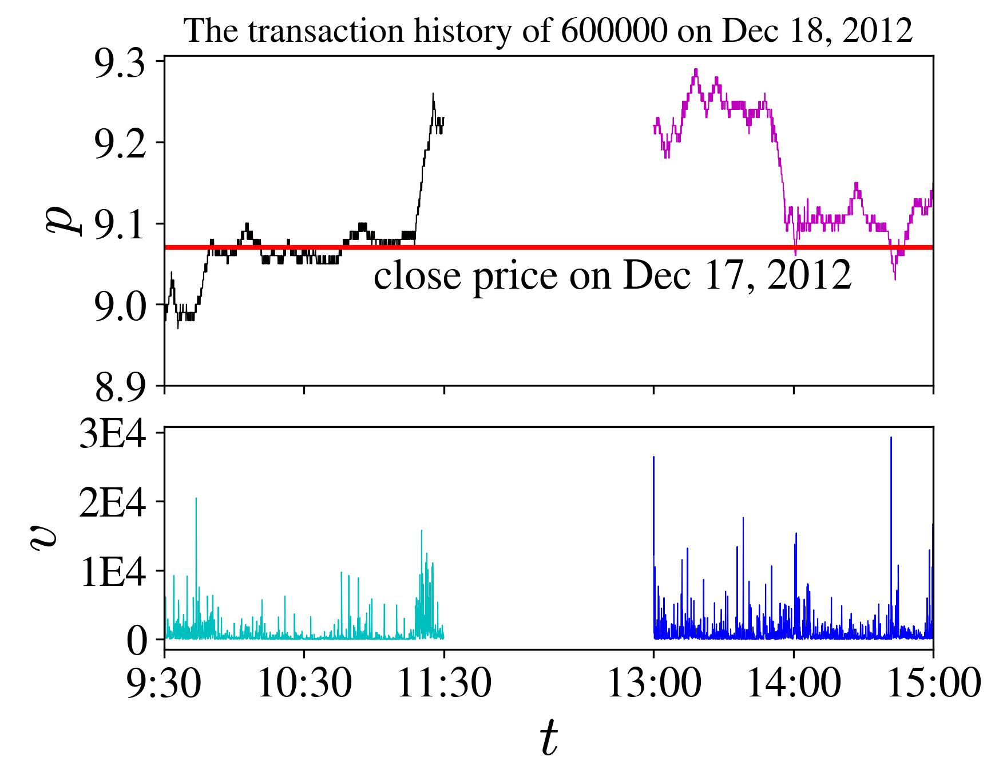
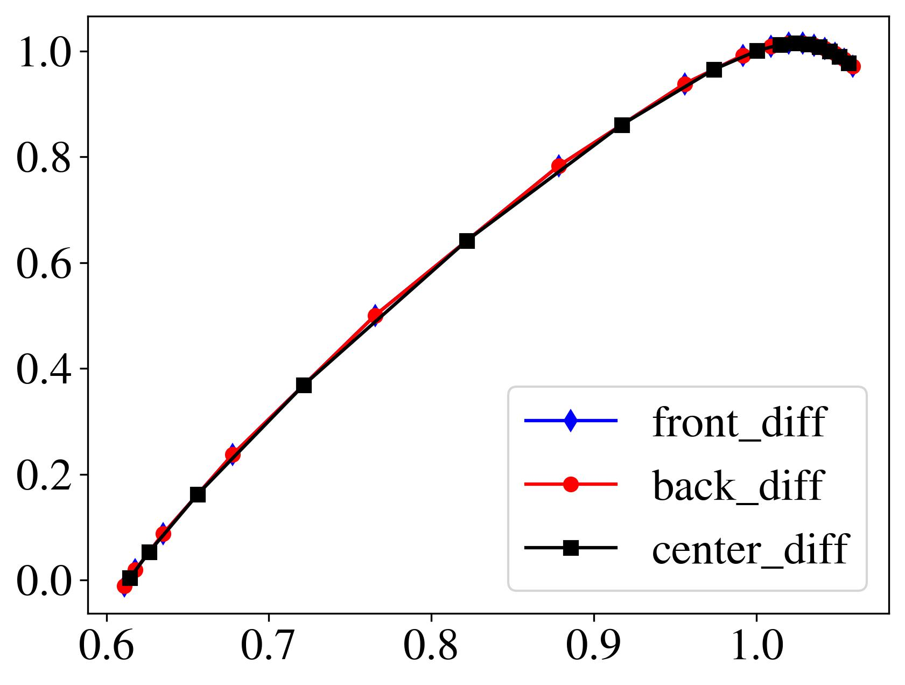

# 金融数值分析

[English](README.md) | [中文](README.zh-CN.md)

Python课程作业，涵盖金融数据处理、数值方法与Matplotlib绘图。

## 作业目录

| 作业 | 内容 |
| --- | --- |
| [01](assignment-01/README.zh-CN.md) | Python数据类型 |
| [02](assignment-02/README.zh-CN.md) | 流程控制与函数 |
| [03](assignment-03/README.zh-CN.md) | NumPy与金融数组 |
| [04](assignment-04/README.zh-CN.md) | Matplotlib与金融图表 |
| [05](assignment-05/README.zh-CN.md) | Pandas与价格模拟 |
| [06](assignment-06/README.zh-CN.md) | 数值求根与交易间隔 |
| [07](assignment-07/README.zh-CN.md) | 不动点与最小二乘 |
| [08](assignment-08/README.zh-CN.md) | 直接求解与模型拟合 |
| [09](assignment-09/README.zh-CN.md) | 迭代求解与因子回归 |
| [10](assignment-10/README.zh-CN.md) | 多项式插值 |
| [11](assignment-11/README.zh-CN.md) | 幂法与金融网络 |
| [12](assignment-12/README.zh-CN.md) | 数值积分与分布 |
| [13](assignment-13/README.zh-CN.md) | 有限差分与随机路径 |
| [14](assignment-14/README.zh-CN.md) | 常微分方程 |

[补充练习](supplementary/README.zh-CN.md)

<!-- gallery:start -->
## 成果展示

### Monte Carlo价格路径

黑线为真实价格，彩线为五条模拟样本路径。

[作业05 · 模拟](assignment-05/extra/exercise-06_monte_carlo_alternative.py)

### 日内价格与成交量

按交易时段展示成交价与成交量，红线标出前收盘价。

[作业04 · 金融图表](assignment-04/exercise-05.py)

### 有限差分比较

比较向前、向后与中心差分。横轴α=dτ(q)/dq，纵轴f(α)=qα−τ(q)。

[作业13 · 有限差分](assignment-13/exercise-01.py)

<!-- gallery:end -->
